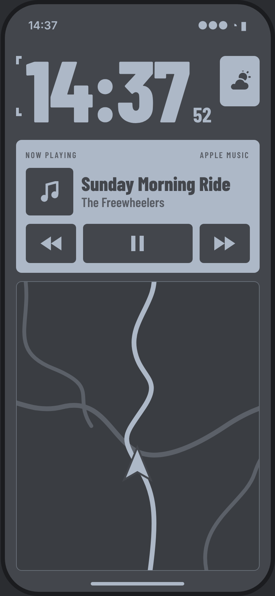

# SPARROW

A minimal bike computer for iPhone (SwiftUI, iOS 17+).

*(Design preview. The real map uses Apple Maps around your actual position.)*

## What's on screen

1. **Clock**: a large 24h `HH:mm` clock, with seconds in small type beside it.
2. **Weather**: a small box next to the clock with an icon for the current conditions (from [Open-Meteo](https://open-meteo.com), free, no API key needed). It refreshes every 15 minutes, or after you have ridden 5 km.
3. **Now playing**: title, artist and artwork from Apple Music, with large glove-friendly previous / play-pause / next buttons.
4. **Map**: a muted Apple Map that follows your position and rotates with your heading. Panning stops the follow mode, and a button brings it back.

The screen stays awake while SPARROW is open.

## Colours

| Role | Hex |
| --- | --- |
| Background (red in the reference) | `#43464C` |
| Lettering, panels and map lines (black in the reference) | `#ADB8C7` |

They are defined in `Sparrow/Theme.swift`.

## Running it

1. Open `Sparrow.xcodeproj` in Xcode 16 or newer.
2. Select the **Sparrow** target, then **Signing & Capabilities**, and choose your team.
3. Run it on an iPhone. Location and Apple Music need a real device to be useful.

On first launch, iOS asks for permission to use your **location** (for the map and the weather) and **Media & Apple Music** (for the now-playing panel).

## Known limitation: podcasts

iOS only lets other apps read and control the **Apple Music** player. What's playing in Apple Podcasts, Spotify, or other apps can't be read by a third-party app, so in that case the panel shows "Nothing playing".
